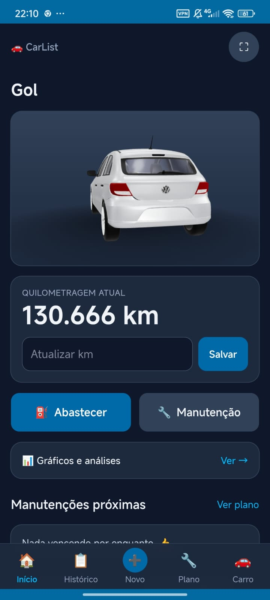
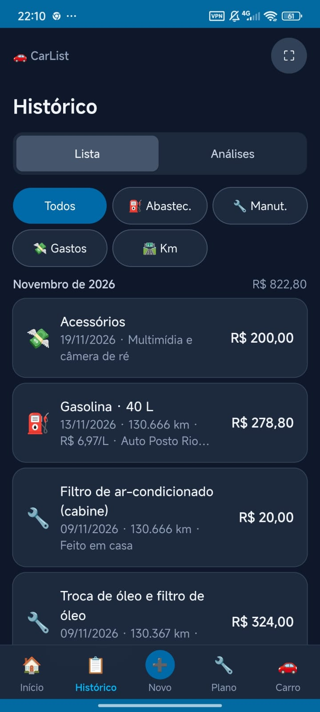
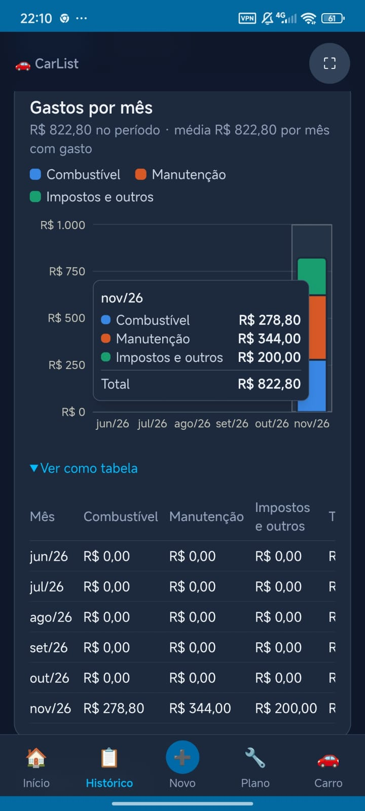
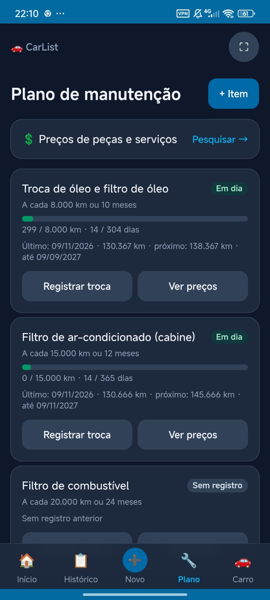
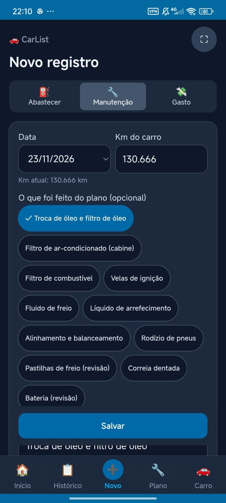
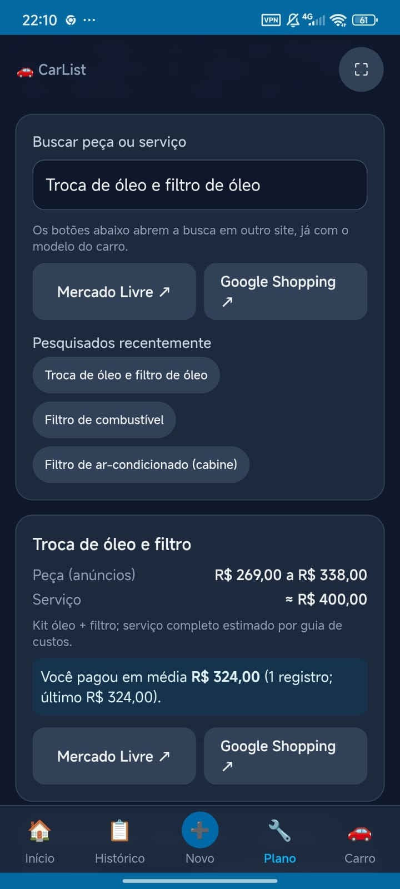
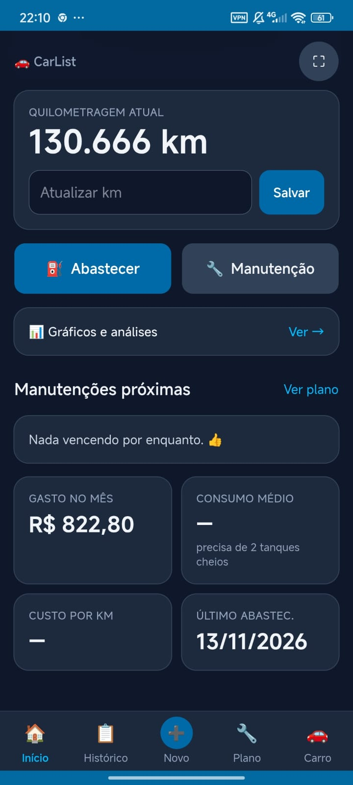
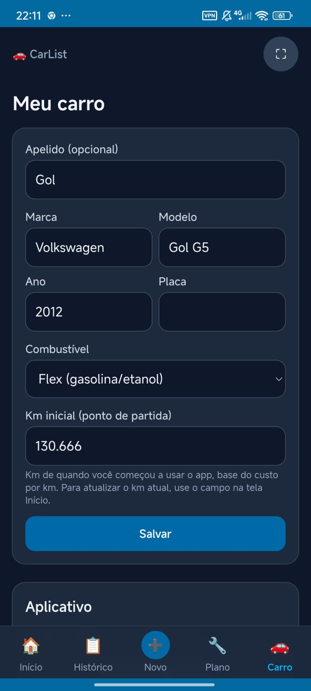
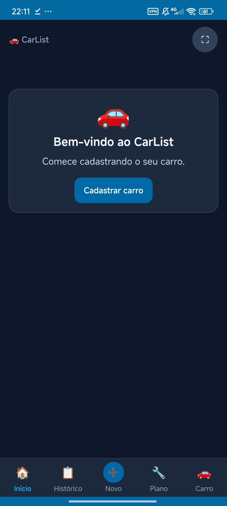

<p align="center"></p>

<h1 align="center">CarList</h1>

App pessoal para controlar **um carro**: manutenções, abastecimentos e consumo, gastos gerais e um
plano de manutenção com alertas. É um **PWA** que funciona **offline**: os dados ficam só no seu
aparelho, sem conta, sem servidor e sem anúncios.

<table>
  <tr>
    <td align="center"><br><sub><b>Início</b> · km atual e carro em 3D</sub></td>
    <td align="center"><br><sub><b>Histórico</b> · por mês, com filtros</sub></td>
    <td align="center"><br><sub><b>Análises</b> · gastos por mês</sub></td>
  </tr>
  <tr>
    <td align="center"><br><sub><b>Plano</b> · progresso por km e prazo</sub></td>
    <td align="center"><br><sub><b>Registrar</b> · vincula ao plano</sub></td>
    <td align="center"><br><sub><b>Preços</b> · referência e busca</sub></td>
  </tr>
  <tr>
    <td align="center"><br><sub><b>Resumo</b> · gasto, consumo, custo/km</sub></td>
    <td align="center"><br><sub><b>Carro</b> · cadastro e backup</sub></td>
    <td align="center"><br><sub><b>Primeiro uso</b></sub></td>
  </tr>
</table>

## O que faz

- **Abastecimentos e consumo:** informe dois entre litros, R$/litro e total e o terceiro é calculado.
  O consumo (km/l) vem do método do tanque cheio.
- **Manutenções:** cada serviço pode marcar um ou vários itens do plano, com valor, oficina e observações.
  O aviso de km compara com os registros vizinhos no tempo, então editar um registro antigo não gera alerta falso.
- **Plano de manutenção:** intervalos por km e/ou meses (vale o que vencer primeiro), barra de progresso,
  status **Em dia / Em breve (80%) / Vencido** e atalhos "Registrar troca" e "Ver preços".
- **Gastos gerais:** IPVA, seguro, licenciamento, multas, pedágio, lavagem e outros.
- **Análises:** gastos por mês, preço do litro e **gasolina x etanol com o consumo real do seu carro**
  (em vez da regra genérica dos 70%). Todo gráfico tem uma tabela alternativa.
- **Preços de peças e serviços:** faixas de referência para o Gol G5, com busca já preenchida com o
  modelo do carro no Mercado Livre e no Google Shopping, e a média do que você já pagou.
- **Backup:** exporta e importa um arquivo JSON, com validação para recusar arquivo malformado.
- **PWA:** instala na tela inicial, abre em tela cheia e funciona sem internet.
- **Modelo 3D** do carro (Three.js), que você gira com o dedo.

> As faixas de preço são **ordens de grandeza** de anúncios e guias online (nov/2026), não cotações.
> Ficam em `src/lib/priceRef.ts` e podem ser ajustadas à mão.

## Tecnologias

React 19, TypeScript, Vite, Tailwind CSS v4, Dexie (IndexedDB), Recharts, Three.js,
vite-plugin-pwa (Workbox) e oxlint.

## Rodar

```bash
npm install
npm run dev        # desenvolvimento (http://localhost:5173)
npm run build      # gera a pasta dist/
npm run preview    # serve o build (http://localhost:4173)
npm run lint
```

## Docker

```bash
docker compose up -d --build   # http://localhost:8080
docker compose down            # parar
```

Build em duas etapas (Node para compilar, nginx para servir). Sem Compose:
`docker build -t carlist .` e `docker run -d -p 8080:80 carlist`.

> Os dados ficam no navegador de quem acessa, não no container. Reconstruir ou apagar o container
> não perde nada.

## Instalar no celular

O PWA só instala em **HTTPS**. Duas formas:

- **Hospedagem estática** (GitHub Pages, Netlify, Cloudflare Pages): publique a pasta `dist/`.
  O app usa `HashRouter` e `base: './'`, então funciona em subcaminhos.
- **Tailscale Serve** (privado, sem publicar nada): com o app rodando em `localhost:8080`,
  `tailscale serve --bg --https=443 http://localhost:8080` cria um endereço HTTPS só da sua rede.

Depois, no **Chrome do Android**: menu ⋮ → **Instalar app**. No iPhone: Compartilhar → **Adicionar à
Tela de Início**. O botão ⛶ no topo alterna a tela cheia (o iPhone não oferece essa API; lá, instalar
já remove a barra do navegador).

Os dados **não** passam de um aparelho para outro sozinhos: use **Carro → Backup → Exportar** num e
**Importar** no outro.

## Modelo 3D do carro

```
models/source/                  arquivos-fonte (pesados, fora do Docker e do git)
public/models/
  vw-gol-g5-prata.glb           modelo usado pelo app (Draco, 6,7 MB)
src/lib/carViewer.ts            visualizador único (não recarrega ao trocar de tela)
src/components/Car3D.tsx        encaixa o visualizador na tela
```

- O visualizador é criado uma vez e começa a carregar na abertura do app; o render pausa quando o carro
  sai da tela ou a aba fica em segundo plano.
- **Trocar o modelo/cor:** edite o `.glb` no Blender, exporte com *Compressão Draco* para `public/models/`
  e ajuste `MODEL_URL` em `carViewer.ts`. Use um **nome de arquivo novo** a cada versão (ex.: `-v2`) para
  os celulares não ficarem com o modelo antigo em cache.

## Estrutura

- `src/db.ts` — modelo de dados (Dexie/IndexedDB)
- `src/lib/stats.ts` — km atual, limites de km, consumo (km/l), custo por km
- `src/lib/plan.ts` — vencimento e progresso do plano de manutenção
- `src/lib/analytics.ts` — gastos por mês, preço do litro, gasolina x etanol
- `src/lib/priceRef.ts` — preços de referência e busca de peças
- `src/lib/backup.ts` — exportar/importar JSON com validação
- `src/pages/` — Início, Histórico, Análises, Registrar, Plano, Preços, Carro

## Roadmap

- [x] Carro, km, abastecimentos (km/l), manutenções, gastos, backup
- [x] Plano de manutenção com alertas por km e data, barras de progresso
- [x] Modelo 3D, instalação e tela cheia
- [x] Análises: gastos por mês, preço do litro, gasolina x etanol
- [x] Preços de referência e busca de peças
- [ ] Anexos: foto/PDF da nota fiscal
- [ ] Notificações de vencimento (manutenção, IPVA, seguro, licenciamento)
- [ ] Exportar histórico do veículo em PDF (para venda)
- [ ] Exportar vencimentos para o Google Agenda (.ics)
- [ ] Backup/sincronização em nuvem
- [ ] Mais de um veículo
